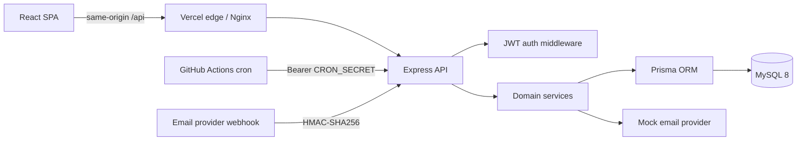

# OutboundX

**A production-minded B2B outbound campaign manager — audiences, campaigns, dispatch, and engagement analytics in one place.**

[](https://github.com/Aditya7615/outboundx/actions/workflows/ci.yml)
[](https://outboundx-phi.vercel.app)
[](https://www.typescriptlang.org/)

**Live demo:** https://outboundx-phi.vercel.app  
**Demo account:** `demo@outboundx.dev` / `Demo@12345`  
**Demo video (4:25):** [Watch the full walkthrough](https://github.com/Aditya7615/outboundx/releases/download/demo-v1/OutboundX-Assignment-Demo.mp4)

[](https://github.com/Aditya7615/outboundx/releases/download/demo-v1/OutboundX-Assignment-Demo.mp4)

---

## Overview

OutboundX is a full-stack application for running outbound email campaigns against a contact audience. It covers the complete workflow: import contacts, target an audience, schedule or send a campaign, deliver through a provider abstraction, and ingest signed engagement events from a webhook.

The project is intentionally built around the details that separate a demo from a maintainable service: indexed schema design, keyset pagination, streamed CSV ingestion, serverless-safe scheduling, HMAC webhook verification, typed API contracts, and a deterministic test suite.

## Features

| Area | Capabilities |
| --- | --- |
| Authentication | Register, login, logout, session restore, JWT cookie + Bearer support, bcrypt password hashing |
| Contacts | Search, status filtering, cursor pagination, CRUD, streamed CSV import with row-level validation |
| Campaigns | Draft/scheduled/sending/completed lifecycle, audience targeting, scheduling, send-now, delivery logs |
| Analytics | Sent/opened/clicked totals, open and click rates, funnel, daily engagement series, per-campaign performance |
| Integrations | Provider abstraction for email delivery, signed webhook endpoint, protected scheduler endpoint |
| Developer experience | Swagger UI, OpenAPI document, seeded demo data, Docker Compose, CI, Vercel configuration |

## Stack

| Layer | Technology |
| --- | --- |
| Frontend | React 19, TypeScript, Vite 5, Tailwind CSS 4, SWR, Recharts |
| API | Node.js, Express 4, TypeScript, Zod |
| Database | MySQL 8, Prisma ORM, SQL migrations |
| Auth | JWT (httpOnly cookie or Bearer), bcrypt |
| Testing | Jest, Supertest, ts-jest, fake Prisma client |
| Hosting | Vercel serverless functions, Aiven MySQL, GitHub Actions |
| Self-hosting | Docker Compose, Nginx |

## Architecture



The Express application is transport-thin: controllers validate input, services own business rules and persistence, and a shared error middleware maps domain errors to consistent HTTP responses.

### Request lifecycle

1. The SPA calls `/api/*` with cookies enabled. Vite proxies locally; Vercel and Nginx proxy in production.
2. Helmet, CORS, cookie parsing, request logging, and rate limiting run at the edge of the API.
3. Auth middleware accepts the `ox_token` cookie or an `Authorization: Bearer` token.
4. Zod validates write payloads before controllers delegate to services.
5. Prisma accesses MySQL; responses use `{ "data": ... }` and errors use `{ "error": { "message": ... } }`.

## Data model

```mermaid
erDiagram
  User ||--o{ Contact : owns
  User ||--o{ Campaign : owns
  Campaign ||--o{ CampaignLog : produces
  Contact ||--o{ CampaignLog : receives

  User { int id PK; string name; string email UK; string passwordHash }
  Contact { int id PK; int userId FK; string email; string status }
  Campaign { int id PK; int userId FK; string title; string status; datetime scheduledFor }
  CampaignLog { int id PK; int campaignId FK; int contactId FK; string status; string providerMessageId UK }
```

- All primary keys are auto-increment integers.
- Contacts are unique per user by email.
- Campaign logs are unique per `(campaign_id, contact_id)` and per `provider_message_id`.
- Indexes cover contact list pages, campaign log pages, and due-campaign dispatch.

## API

Base URL: `/api`. Interactive docs: `/api/docs`. Raw spec: `/api/openapi.json`.

| Method | Route | Description |
| --- | --- | --- |
| `POST` | `/auth/register` | Create an account |
| `POST` | `/auth/login` | Start a session |
| `POST` | `/auth/logout` | Clear the session cookie |
| `GET` | `/auth/me` | Current user |
| `GET` | `/contacts` | Cursor-paginated contacts (`limit`, `cursor`, `status`, `search`) |
| `POST` | `/contacts` | Create a contact |
| `PATCH` | `/contacts/:id` | Update a contact |
| `DELETE` | `/contacts/:id` | Delete a contact |
| `POST` | `/contacts/import` | Import contacts from a CSV file |
| `GET` | `/campaigns` | List campaigns |
| `POST` | `/campaigns` | Create a draft or scheduled campaign |
| `GET` | `/campaigns/:id` | Campaign detail and stats |
| `PATCH` | `/campaigns/:id` | Update a campaign |
| `DELETE` | `/campaigns/:id` | Delete a non-sending campaign |
| `POST` | `/campaigns/:id/dispatch` | Send now |
| `GET` | `/campaigns/:id/logs` | Cursor-paginated delivery logs |
| `GET` | `/analytics/overview` | Dashboard aggregates (`days` 7–90) |
| `POST` | `/webhooks/email` | Signed `opened` / `clicked` events |
| `POST` | `/internal/dispatch-due` | Scheduler endpoint protected by `CRON_SECRET` |
| `GET` | `/api/health`, `/health` | Liveness and database health |

### Webhook contract

`POST /api/webhooks/email` requires an `x-webhook-signature` header containing the hex HMAC-SHA256 of the **raw** request body using `WEBHOOK_SECRET`.

```json
{
  "messageId": "mock_e4b3390d-cbaf-4958-b57e-4465cbb853c8",
  "type": "opened",
  "timestamp": "2026-11-02T17:25:30.000Z"
}
```

Events only move forward: `sent → opened → clicked`. Late or duplicate events are ignored. Unknown message IDs return `404`; invalid signatures return `401`.

## Quick start

### Prerequisites

- Node.js 20+ (22 recommended)
- npm 10+
- MySQL 8+ or Docker

### Local development

```bash
git clone https://github.com/Aditya7615/outboundx.git
cd outboundx
npm install
cp backend/.env.example backend/.env
```

Create the database and user described in `backend/.env`:

```sql
CREATE DATABASE outboundx CHARACTER SET utf8mb4 COLLATE utf8mb4_unicode_ci;
CREATE USER 'outboundx'@'localhost' IDENTIFIED BY 'outboundx';
GRANT ALL PRIVILEGES ON outboundx.* TO 'outboundx'@'localhost';
FLUSH PRIVILEGES;
```

Then apply the schema, seed the demo workspace, and start both processes:

```bash
npm run db:migrate
npm run db:seed
npm run dev
```

- Web: http://localhost:5173
- API: http://localhost:4000
- Swagger: http://localhost:4000/api/docs

### Docker Compose

```bash
cp .env.example .env
docker compose up --build
```

- Web: http://localhost:8080
- API: http://localhost:4000
- Swagger: http://localhost:4000/api/docs

The API entrypoint applies migrations and seeds the demo workspace when `SEED_DEMO=true`. The long-running Docker deployment uses the in-process 30-second scheduler.

## Deployment

The hosted demo uses a single Vercel project for the SPA and the Express API, with Aiven MySQL as the database.

| Component | Service | Notes |
| --- | --- | --- |
| Web + API | Vercel | `vercel.json` builds the frontend and routes `/api/*` and `/health` to `api/[...path].ts` |
| Database | Aiven MySQL | Free tier; `DATABASE_URL` uses `sslaccept=accept_invalid_certs` for the Aiven CA |
| Scheduler | GitHub Actions | `.github/workflows/dispatch.yml` calls the protected dispatch endpoint every five minutes |
| CI | GitHub Actions | MySQL-backed migrations, seed, lint, typecheck, tests, and frontend build |

### Required production environment variables

| Variable | Purpose |
| --- | --- |
| `DATABASE_URL` | MySQL connection string |
| `JWT_SECRET` | Token signing key, at least 32 characters |
| `JWT_EXPIRES_IN` | Token lifetime, default `7d` |
| `CORS_ORIGIN` | Comma-separated allowed web origins |
| `COOKIE_SECURE` | `true` behind HTTPS |
| `WEBHOOK_SECRET` | HMAC key for provider callbacks |
| `CRON_SECRET` | Bearer secret for the internal dispatch endpoint |
| `LOG_LEVEL` | Pino log level |

GitHub Actions additionally needs repository secrets `APP_URL` and `CRON_SECRET`.

### Why serverless needs a cron endpoint

Vercel functions are request-scoped and cannot own a long-running interval. The Docker deployment keeps the 30-second scheduler in `backend/src/index.ts`; the serverless deployment exposes `POST /api/internal/dispatch-due`, which the scheduled workflow calls with a bearer secret. Both paths run the same `CampaignService.dispatchDue()` implementation.

## Project structure

```text
.
├── api/                         Vercel serverless entrypoints
├── backend/
│   ├── prisma/                  Schema, migration, seed, sample CSV
│   ├── scripts/                 Signed webhook helper
│   ├── src/
│   │   ├── config/              Environment and Prisma client
│   │   ├── controllers/         HTTP boundary
│   │   ├── middlewares/         Auth, errors, rate limits, upload
│   │   ├── routes/              Route tables
│   │   ├── services/            Business logic and provider abstraction
│   │   ├── types/               Express request augmentation
│   │   ├── utils/               Cookies, JWT, mappers, pagination
│   │   └── validation/          Zod schemas
│   └── tests/                   Unit and Supertest integration suites
├── frontend/
│   └── src/
│       ├── components/          Layout and UI primitives
│       ├── features/            Auth, charts, contact modals
│       ├── hooks/               Reusable hooks
│       ├── lib/                 Formatting and class helpers
│       ├── pages/               Lazy-loaded route views
│       └── services/            Typed API clients
├── docs/                        Architecture and onboarding notes
├── .github/workflows/           CI and scheduler workflows
├── vercel.json                  Vercel build, function, and routing config
└── docker-compose.yml           Self-hosted stack
```

## Implementation notes

- **Keyset pagination** avoids `OFFSET` scans and keeps pages stable while rows are inserted. Cursors are opaque base64url values.
- **Streamed CSV import** uses `csv-parse`, 500-row batches, `createMany({ skipDuplicates: true })`, a 5 MB upload limit, and a 20,000-row ceiling.
- **Dispatch** caps audiences at 5,000 recipients, rejects larger audiences, sends with concurrency 20, and records one delivery log per recipient.
- **Webhook verification** runs over the raw request body before JSON parsing, with constant-time signature comparison.
- **Analytics** use grouped aggregates plus a single raw SQL daily series rather than loading logs into memory.
- **Serverless routing** funnels every `/api/*` path through one Express function; the catch-all rewrite is required because Vercel's `[...path]` functions do not match nested paths by default.

## Scripts

| Command | Description |
| --- | --- |
| `npm run dev` | Run API and web concurrently |
| `npm run build` | Build backend and frontend |
| `npm run test` | Backend Jest suite |
| `npm run typecheck` | TypeScript checks for both workspaces |
| `npm run lint` | ESLint for both workspaces |
| `npm run db:migrate` | Apply Prisma migrations |
| `npm run db:seed` | Seed the demo workspace |
| `npm run db:reset` | Reset schema and reseed |
| `npm run webhook:test -w backend -- opened` | Send a signed local webhook for the latest log |

## Testing

```bash
npm run typecheck
npm run lint
npm run test
npm run test:coverage -w backend
```

The suite currently covers cursor encoding, analytics math, auth, contact import, campaign dispatch (including audience limits), webhook verification, and HTTP integration behavior. CI applies migrations and seeds a real MySQL 8.4 service to catch schema drift.

## Security

- Passwords are hashed with bcrypt and never returned by the API.
- JWTs are `httpOnly`, `SameSite=Lax`, and `Secure` in HTTPS deployments.
- Zod validates every write payload; Prisma parameterizes queries.
- CORS is restricted to configured origins.
- Webhook signatures are verified before parsing and compared in constant time.
- Internal dispatch uses a bearer secret compared with a constant-time SHA-256 digest.
- Helmet and response security headers are enabled; uploads and JSON bodies are size-limited.

## Limitations and next steps

- Email delivery is a deterministic mock provider. A real integration would add retries, provider idempotency keys, bounce handling, and a durable queue.
- Dispatch is single-instance for the demo. Production would use a leased job table or queue and separate send fan-out from status transitions.
- Analytics are computed on demand. At higher volumes, rollup tables or a warehouse would be appropriate.
- The app is single-workspace per user; multi-tenant workspaces and role-based permissions are the next schema change.
